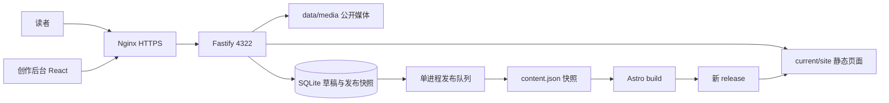

# 架构、技术栈与模块

核对日期：2026-10-02。入口：[文档索引](README.md)。

## 技术栈

下表是 `package.json` 声明范围，精确安装版本由 `package-lock.json` 锁定。升级使用锁文件和验证结果，不凭本文中的范围替换依赖。

| 层 | 技术 | 用途 |
| --- | --- | --- |
| 运行时 | Node.js >=24.22.1 <25，ESM | 原生 `node:sqlite`、HTTP 服务和运行时静态构建 |
| 前台 | Astro ^7.3.5 | `output: static`，完整 HTML、SEO、RSS、搜索索引 |
| 后台 | React / ReactDOM ^19.1.1，Vite ^6.4.5 | `/admin/` 创作管理 SPA，lucide-react 图标 |
| 服务 | Fastify ^5.12.6 | Cookie、多文件上传、局部限流、静态文件分发 |
| 数据 | SQLite，WAL、外键 | 文章、版本、设置、评论、会话、发布任务 |
| 校验 | Zod ^4.1.0 | API 输入约束 |
| 排版 | markdown-it ^14.3.3 + anchor / footnote / task-lists / texmath | 标题锚点、脚注、任务列表、公式 |
| 公式与代码 | KaTeX ^0.18.2，Shiki ^3.12.0 | 公式输出经清洗的原生 MathML；代码高亮和复制 |
| 内容安全 | sanitize-html ^2.18.1 | Markdown 和历史 HTML 的统一清洗 |
| 导入与归档 | yaml ^2.8.1，JSZip ^3.10.1 | YAML/JSON Front Matter、MD/ZIP 导入、备份导出；元数据不执行代码 |
| 类型检查 | TypeScript ^5.9.2 | `tsc --noEmit`；`allowJs=true`、`checkJs=false`，不代表后端 JS 已完整类型检查 |
| 部署 | Docker Compose，node:24.22.1-bookworm-slim，Nginx | Linux x64/ARM；TLS、反向代理；实际代理版本须在部署环境核实 |

## 访问与发布链路

读者页面由预生成 HTML 提供，搜索在浏览器读取静态索引；评论、访问量、喜欢调用 API。管理员登录后编辑数据库草稿，显式发布时构建新目录并切换 `data/current`。编辑器主按钮按可见性切换：公开内容“发布”，私密内容“保存”（保存草稿；已有公开版本时自动排队取消发布）；私密模式隐藏重复的“保存草稿”按钮。详见 [发布一致性与失败边界](DATA-MODEL.md)。

### 后台系统更新链路

管理员“系统更新” → 已有会话/CSRF/Origin 校验 → 私有 DATA_DIR/system-update 文件队列 → Compose 唯一 updater 容器 → 固定 GitHub 来源与分支快进检查 → 临时 Git 工作树构建候选镜像 → 维护写屏障/在途请求及发布排空 → 完整备份 → 切换代码/镜像 → initialize 按 APP_REVISION 重建已发布快照 → 校验新 revision/静态标记 → 完成。失败暂停自动检查；切换后尝试恢复旧代码/镜像/静态入口，不覆盖当前数据库。blog 不持有 Git 或 Docker 控制权限；updater 具有 Docker socket 和专用源码读写权限，使用 flock 跨 PID 命名空间互斥，来源分支必须可信。完整配置、安全边界和不能自动恢复的情况见 [运维](OPERATIONS.md#后台-github-更新)。

## 实现路线与保留原则

已完成的路线是：解析 Halo 备份和历史增量快照 → 将文章、页面、版本、评论、分类及媒体写入自有模型 → 保留固定链接与视觉资产，构建响应式 Astro 页面 → 实现 React 创作后台和 Fastify API → 加入版本化静态发布、备份验证、缓存响应头；实际迁移验收与部署记录仅在私有环境保存。

迁移不依赖运行中的 Halo。原始来源元数据留在数据库用于追溯，公开导出会去掉文章 `source`。历史内容不是重写生成的文章。缺失原件必须按迁移报告记录，不能宣称已恢复。

## 文件与职责

| 文件 / 目录 | 职责与联动 |
| --- | --- |
| `src/layouts/Site.astro` | 共同页面外壳、SEO、左右栏、导航、搜索弹层、主题初始化、可选统计脚本 |
| `src/components/PostCard.astro`、`Listing.astro`、`Icon.astro` | 列表卡片、分页与统一 SVG 图标 |
| `src/styles/site.css` | 前台主题变量、透明卡片、正文排版、断点和动效降级 |
| `server/themes.mjs`、`src/styles/kiln.css`、`src/scripts/kiln.ts`、`src/scripts/mascot-scene.ts`、`src/components/Mascot.astro`、`MascotStage.astro` | 可选前台主题登记；窑火主题样式（全部限定在 `:root[data-skin=kiln]`）、交互、吉祥物动作调度（山坡几何与动作选择为可测试纯函数）、像素吉祥物与舞台 |
| `src/scripts/site.ts` | 主题、移动菜单、搜索、代码复制、图片放大、目录高亮、评论与计数；启动背景动画 |
| `src/scripts/background.ts` | 共享 Canvas 生命周期；Dream 星点与短流星、窑火余烬两个场景；尺寸变化、页面隐藏/恢复与减少动态偏好 |
| `src/lib/content.mjs` | 构建快照读取、公开文章排序、摘要、正文转换、友链特殊渲染与资源映射 |
| `src/pages/` | 静态路由和索引，见下表 |
| `admin/src/main.tsx` | API 客户端和后台状态；App、Login、Editor、JobRows、Media、Comments、Taxonomy、SiteSettings、Account |
| `admin/src/style.css` | 后台桌面侧栏、移动抽屉、表单与编辑器布局 |
| `admin/vite.config.ts` | `/admin/` 基路径、开发代理、`dist/admin` 输出 |
| `server/index.mjs` | API 注册、Zod schema、鉴权接入、响应头、静态分发与错误处理 |
| `server/db.mjs` | 建表、默认设置、草稿与版本读写、公开内容导出、路径验证 |
| `server/auth.mjs` | scrypt 密码哈希、会话创建、Token 哈希与有效期 |
| `server/license.mjs`、`src/components/Copyright.astro` | 每篇内容许可默认值/常用预设与版权区域，编辑器设置随文章发布 |
| `server/markdown.mjs` | 统一 Markdown/HTML 清洗、代码与公式、Front Matter 解析 |
| `server/uploads.mjs` | 上传限额、ZIP 路径检查、媒体保存、相对资源引用改写 |
| `server/publish.mjs` | 构建队列、快照、release、发布状态、旧链接页、可选 CDN 清除 |
| `server/backup.mjs` | 数据库在线备份、媒体和清单打 ZIP |
| `server/update-source.mjs`、`server/system-update.mjs`、`admin/src/SystemUpdate.tsx` | 共享内置规范开源仓库/main 默认来源、精确 origin 校验；私有更新文件队列、配置/心跳/维护写屏障与后台更新页；来源显示不依赖执行器在线，独立于站点公开 settings |
| `scripts/update-worker.mjs`、`Dockerfile.updater`、`scripts/updater-entrypoint.sh`、`scripts/verify-compose.sh` | Compose 单执行器、工具镜像与降权入口、flock、GitHub 快进检查、隔离构建、备份/切换/回退与真实容器烟测 |
| `scripts/import-halo.mjs` | 一次性 Halo 导入，拒绝已有文章数据库 |
| `scripts/recover-assets.mjs`、`archive-external-images.mjs` | 迁移资源补全，使用前逐项阅读，不能当日常更新脚本 |
| `scripts/initialize.mjs`、`create-admin.mjs` | 容器初始化、首次管理员和首次站点构建 |
| `scripts/backup.mjs`、`verify-backup.mjs` | 备份命令及恢复完整性验证 |
| `tests/core.test.mjs`、`tests/background.test.mjs`、`tests/markdown-security.test.mjs`、`tests/system-update.test.mjs` | 隔离数据库核心回归、背景动画生命周期、元数据/排版安全、更新编排/维护计数/初始化/主题发布回归 |
| `scripts/verify-container.mjs`、`.github/workflows/ci.yml` | 隔离 CI 容器首次初始化/重启烟测；必须显式 CONTAINER_SMOKE_TEST=true，不用于生产数据 |
| `scripts/verify-workflow.mjs`、`verify-preview.mjs` | 迁移阶段流程与服务验收，使用限制见运维文档 |
| `Dockerfile`、`compose.yaml`、`deploy/nginx-oracle.conf` | 正式部署入口 |

## 前台路由

| 路由 | 源码 | 行为 |
| --- | --- | --- |
| `/` | `src/pages/index.astro` | 首页，置顶优先、发布时间倒序，每页 10 篇 |
| 文章/页面的 `path` | `src/pages/[...route].astro` | 正文、目录、元信息；文章有上一篇/下一篇 |
| `/categories/:slug`、`/tags/:slug` | 同上 | 以配置名称匹配文章分类标签 |
| `/page/:n`、`/index/page/:n` | 同上 | 两组分页路径兼容 |
| `/archives`、`/categories` | 对应 `.astro` 页面 | 年月归档、分类入口 |
| `/search-index.json` | `search-index.json.ts` | 仅公开文章，字段 title/path/excerpt/text；客户端最多显示 30 项 |
| `/rss.xml`、`/sitemap.xml` | 对应 `.ts` 文件 | RSS 为文章摘要；sitemap 含公开内容与分类标签入口 |
| `/404` | `404.astro` | Fastify 未找到文件时返回此产物并设置 404 |
| `/you-lian` | 通用内容页 + `bodyOf` | 特殊生成友链表；不能仅改正文期待替换友链设置 |

## 视觉与响应式契约

桌面为左资料栏、中间正文、右公告/目录三栏。最大容器宽度分档为 1152px（1200–1407px）、1344px（1408–1699px）、1600px（>=1700px），侧栏分别占内部宽度的 24%、21%、19%，两处间距各 22px，正文自适应。保留 1200px 三栏断点；参考原站 Dream 的分档留白，同时维持既有平板和手机导航。

背景图片采用 center top / cover。夜间在背景层叠加 70% 黑色遮罩（等效原站 brightness(.3)），星点 Canvas 位于遮罩上方、内容下方，不拦截点击。默认夜间卡片与顶栏为 rgba(40,44,52,.6)，卡片悬停 .8；正文 #999、标题 #c0c0c0、元信息 #777。日间正文 #606266、标题 #333、元信息 #909399。后台原有 cardOpacity 仍通过 CSS 变量调节卡片透明度，不修改保存的数据。

沿用本地 WenCang 字体（Dream），在 Site.astro 预加载；列表标题 22.4px/1.25，摘要 15.4px/1.5，正文 16px/1.8，手机继续使用其独立字号/行距。明暗主题使用 CSS 变量与 data-theme，用户选择保存在 localStorage；无有效手动选择时跟随系统变化。

背景动态为缓慢向右上漂移、闪烁的星点与偶发短流星，最多 300 星点、2 条流星，30 FPS、DPR 上限 2。页面隐藏/pagehide 暂停，恢复后继续；prefers-reduced-motion 停止并清空背景动画，同时关闭卡片入场、头像旋转和过渡，返回顶部也改为即时滚动。

### 可替换主题

站点设置 `siteTheme` 选择前台主题，默认 `dream`（上述原站视觉）。主题在构建时写入 `<html data-skin>`，保存设置后须重新发布站点才生效。两套样式都会打包，新主题样式必须全部限定在对应 `data-skin` 选择器下，不能改动其他主题的输出。

窑火 `kiln` 为仅深色主题：`data-dark-only` 固定 `data-theme=dark`，隐藏明暗切换、忽略系统配色变化；不使用 background、accent 设置和 WenCang 字体预加载，cardOpacity 仍参与卡片透明度。视觉为暖调深色底、渐隐点阵、Canvas 余烬（最多 90 颗，复用 30 FPS / DPR 2 / 隐藏暂停生命周期）、毛玻璃卡片和珊瑚色强调色 #d97757；标题衬线、元信息等宽，不使用外部字体或 emoji。像素吉祥物为 22x16 网格 SVG，始终正对读者；身体（`.m-skin`）与眼睛（`.m-eye`）分开着色，悬停只提亮身体。姿态由 `data-pose` 切换眼型（睁眼/闭眼/笑眼）、双臂、腮红和旗帜。资料卡舞台由 `kiln.ts` 按权重编排场景，不连续重复：走动张望、走到火堆旁烤火（火势变旺，部分时候就地打瞌睡）、登山、想象（漫画惯例：思考泡泡最小圆点贴近头部右上角，斜向上展开，内含灯泡/星星/代码/月亮像素图标）、打瞌睡（闭眼、慢呼吸、飘出 z，结束后伸懒腰）、仰望。山默认不出现：登山时吉祥物原地行走、舞台星点与地面刻度反向滚动，营火向右移出、山从左侧滑入；登顶举旗后下山，再原路返回营地。点击跳跃并按当前动作显示短句，打瞌睡时点击会惊醒。营火由三帧像素火焰循环、余烬闪烁、火星上升与呼吸光晕组成。页脚和 404 的吉祥物原地张望、仰望或小睡；搜索框标题中的吉祥物输入时作阅读状。交互：首屏卡片错峰入场，首屏以下卡片进入视口时显现；卡片指针光斑与列表卡片悬停上浮（仅可悬停设备），触屏为按压缩放反馈；导航下划线滑入；文章页顶栏阅读进度条；滚动超过一屏显示返回顶部；`/` 打开搜索（输入框内不触发）；搜索框与图片放大弹出动画；抽屉 Esc 或点击外部关闭。减少动态偏好下关闭所有动画、场景编排和眼睛跟随，延迟显现的卡片直接可见。页面隐藏、抽屉关闭（舞台宽度不足）时不调度场景；动画时间线停滞时按超时继续，不会卡住。

窑火的手机端（<=767px）在首页、分页、分类/标签列表、归档等非文章页把资料卡作为紧凑卡片放在文章列表上方（60px 头像与名称/简介/所在地横排并垂直居中，简介最多两行，舞台高 88px（容纳旗帜与思考泡泡），统计三列带分隔线）；文章页直接从正文开始。抽屉菜单顶部也有吉祥物舞台，导航为两列大按钮。平板和桌面断点与 Dream 相同。

| 宽度 | 前台布局 | 后台布局 |
| --- | --- | --- |
| >=1200px | 完整三栏，侧栏 sticky | 固定侧栏 + 工作区 |
| 768–1199px | 左栏 250px + 正文，隐藏右栏；文章内折叠目录 | 缩窄侧栏与工作区 |
| <=767px | 单栏，隐藏两侧栏，抽屉导航与文章内目录，评论表单单列 | 抽屉侧栏、适配手机的表单与工具栏 |
| >=1408px、>=1700px | 扩大三栏容器，按上述分档调整侧栏占比 | >=1700px 调整工作区留白 |

验收不能只测一个浏览器窗口。至少验证 360、390、767、768、1199、1200、1440、1920px 的首页、长文章、搜索和后台编辑器；长代码/表格/公式在组件内滚动，页面不应整体横向溢出。检查键盘焦点、图片放大、目录和 `prefers-reduced-motion`。

## 后续可选改进（未实现）

版本化数据库迁移；后台组件拆分与类型收紧；更完整 ZIP 引用改写与批量导入事务；发布崩溃恢复日志和共享队列；媒体 MIME 检查与私有媒体权限；release/备份保留策略与异地定时备份；结构化 OpenAPI 与自动契约校验。按真实需求实施，不把这些写成当前能力。
